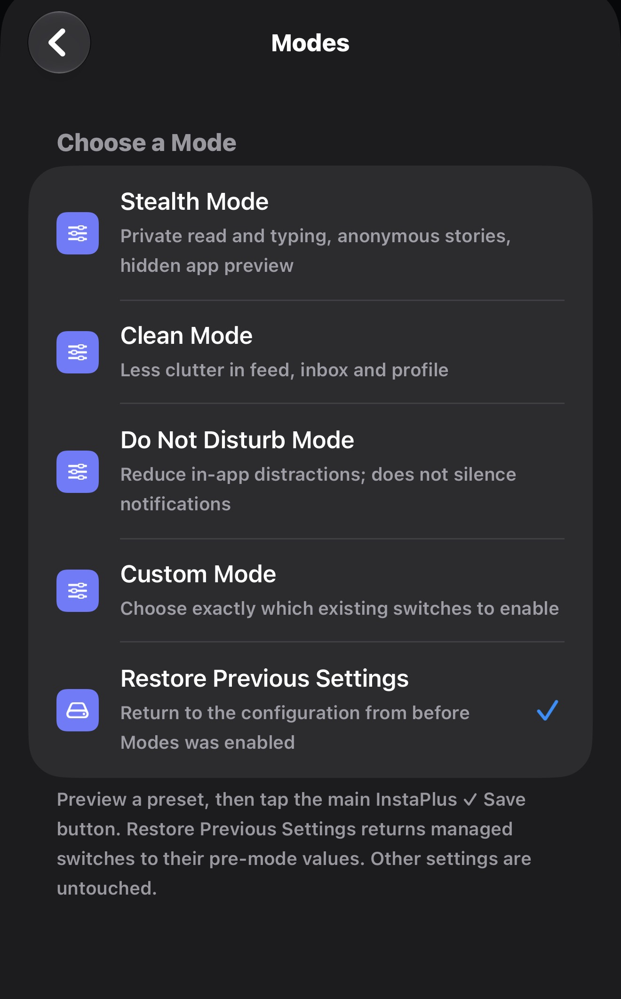
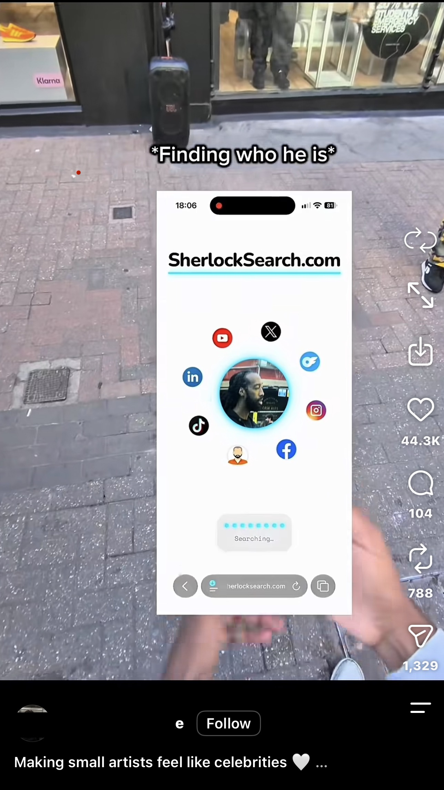
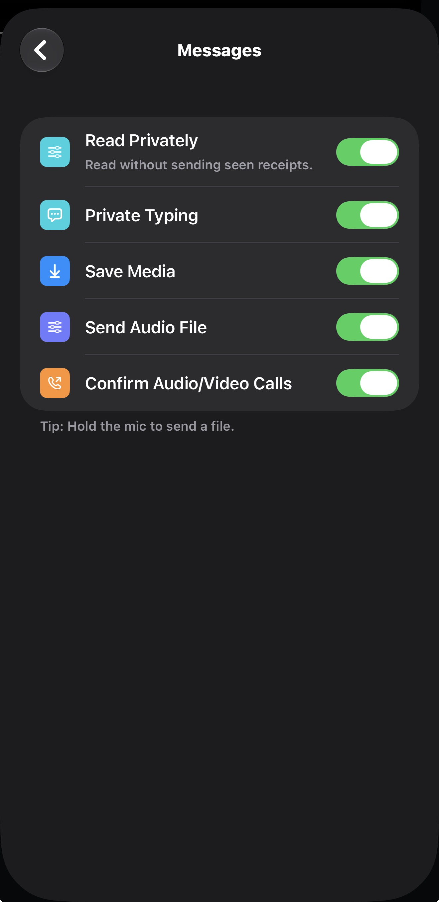
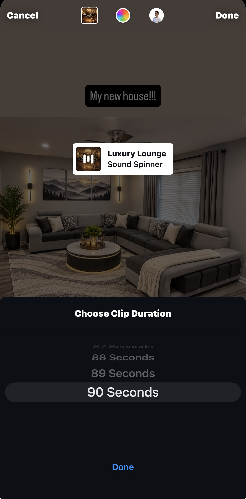
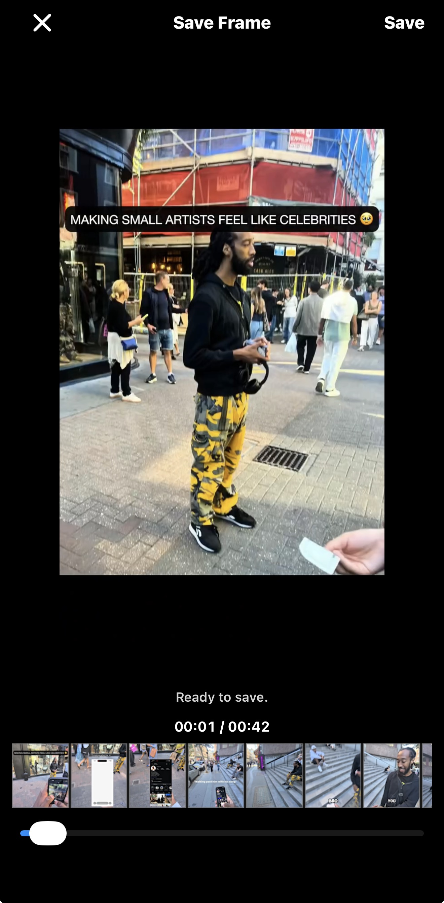

# InstaPlus

Extra Instagram features for downloads, privacy, customization, and media tools.

## About

InstaPlus is a tweak project made to add useful extra features to Instagram while keeping the experience clean and practical.

I’m new to tweak development and still learning as I build. I sometimes use AI tools to help me learn, research, troubleshoot, and move faster, but the project is still guided, tested, and refined by me.

## Features

### Current / Stable
- Download photos, videos, Stories, and Reels
- Expand supported media
- Reel media controls
- Native Reel Auto-Advance
- 90-second Story Music
- Privacy and customization options
- Settings cleanup and update checker

### In Development / Testing
- Reel and Story Frame Capture
- Search Story Viewers
- More advanced media tools

## Screenshots

### InstaPlus Settings

### Selected Modes

### Reel Media Controls

### Message Privacy

### 90-Second Story Music

### Frame Capture

### Search Story Viewers

## Compatibility

- Instagram 438.0.0------> Newest( 11/20/26) Some feature MAYNOT work on the newest version. It's always best to stay to the LOWEST version possible. 
- iOS 16.0 or later

## Installation

Download the latest `.deb` from the Releases section and inject it into a compatible Instagram IPA using your preferred signing tool.

## Releases

The latest public release is available in the [Releases](../../releases) section.

## Support

Developer: **4nil5en**  
Support email: **dev.4nil5en.help+ins@gmail.com**

## Notes

This project is actively being improved. Some features may still be experimental until they are fully tested and confirmed stable.
with that said, please report any bugs and feature suggestion!! It's always welcomed!
