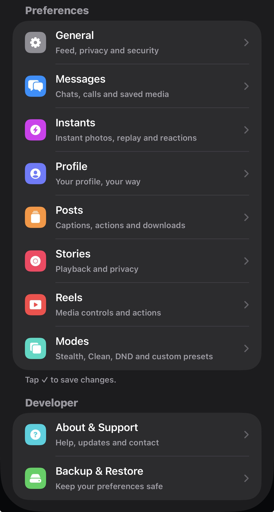
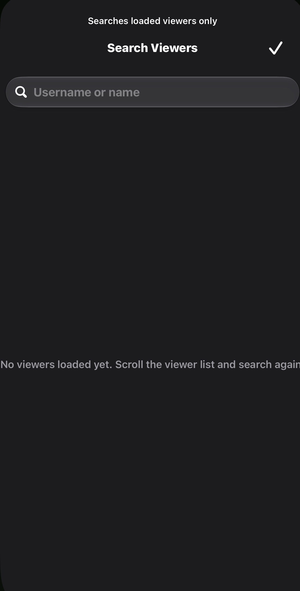

# InstaPlus

Extra Instagram features for downloads, privacy, customization and media management.

## About

InstaPlus is an independent tweak for Instagram. I'm learning tweak development as I build this project. I use AI tools to help with research, coding and troubleshooting, and personally guide and test the features.

## What's new in 1.0.4

- **Smart Media Vault:** Store photos, videos and audio in an encrypted vault with a separate PIN and optional Face ID recovery.
- **Vault media tools:** Video thumbnails, built-in video and audio players, audio repeat, duplicate detection, storage details, media information, multi-select, export and delete.
- **Download destinations:** Choose iPhone, Vault or ask each time.
- **Remember Scroll Position:** Return to your place in the Home feed during the same feed session.
- **Story Viewer Search:** Find viewers more easily.
- **Welcome guide:** New users can find InstaPlus Settings, review the user agreement and enable the tweak.
- **Settings and support:** Improved settings layout and a quick link to support development.
- **Release cleanup:** Simpler messages and less development-only logging in the production build.

## Features

- Download and expand supported posts, Stories and Reels.
- Reel playback controls, including loop and auto-advance.
- 90-second Story Music.
- Message privacy, media tools and call confirmation.
- Profile, feed, Story and Instants customization.
- Settings search, modes, backup and restore, compatibility checks and an update checker.

## Screenshots

Existing screenshots show the interface from earlier builds.

### InstaPlus Settings

### Selected Modes

### Reel Media Controls

### Message Privacy

### 90-Second Story Music

### Search Story Viewers

## Compatibility

- Tested target for 1.0.4: Instagram **438.0.0** on iOS 27.0.
- The project targets iOS 16 or later; other iOS and Instagram versions have not all been tested.
- Newer Instagram builds may change internal APIs and break individual features.
- The 1.0.4 package is an ARM64, rootful-layout DEB intended for compatible IPA injection tools. It is not a native rootless jailbreak package.

## Installation

1. Download the latest available DEB from [Releases](../../releases).
2. Inject it into a compatible Instagram IPA using your preferred signing tool.
3. Open Instagram and follow the welcome guide.
4. Go to Profile > Menu > InstaPlus Settings, accept the agreement and enable InstaPlus if needed.

Keep copies of important media outside the Vault. Removing the app or its data may remove your saved media.

## Support

Developer: **4nil5en**  
Support email: **dev.4nil5en.help+ins@gmail.com**

Bug reports and feature suggestions are welcome. Include your Instagram version, iOS version and InstaPlus version when reporting an issue.

## Disclaimer

InstaPlus is unofficial and is not affiliated with Instagram or Meta. Modified apps can cause compatibility issues, data loss or account restrictions. Use at your own risk.
